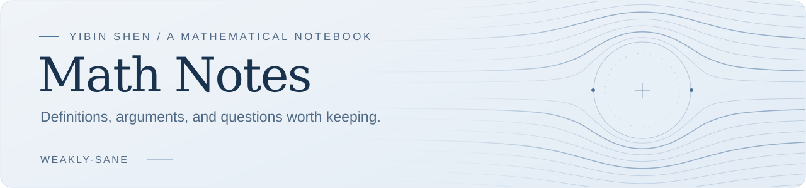

<picture>
  <source media="(prefers-color-scheme: dark)" srcset="assets/header-dark.svg">
  <source media="(prefers-color-scheme: light)" srcset="assets/header-light.svg">
  
</picture>

  <a href="#course-notes"><b>Course notes</b></a>
  &nbsp; · &nbsp;
  <a href="#research-reading">Research reading</a>
  &nbsp; · &nbsp;
  <a href="STYLEGUIDE.md">Writing conventions</a>
  &nbsp; · &nbsp;
  <a href="https://github.com/weakly-sane">Profile</a>

A personal collection of mathematical notes, worked problems, and paper-reading notes, with an emphasis on **analysis**, **partial differential equations**, and **fluid mechanics**.

**Yibin Shen** · University of Science and Technology of China (USTC)

## Course notes

| Subject | Topics |
| :--- | :--- |
| **[Measure Theory](notes/measure-theory/README.md)** | Measurability · integration · convergence |
| **[Probability Theory](notes/probability/README.md)** | Random variables · expectation · independence |
| **[Graph Theory](notes/graph-theory/README.md)** | Graphs · planar graphs · proofs and exercises |
| **[Partial Differential Equations](notes/pde/README.md)** | PDE foundations · analytical methods |

## Research reading

**[Navier–Stokes equations →](research/navier-stokes/README.md)**  
Liouville-type questions, regularity, and foundational estimates.

**[A note on Navier–Stokes scaling →](research/navier-stokes/scaling.md)**  
A worked example of notation and scaling computations.

## Write a note

Choose a starting point, then follow the [writing conventions](STYLEGUIDE.md) for notation, references, and proof style.

| Template | Use it for |
| :--- | :--- |
| [General note](templates/note-template.md) | Definitions, results, and examples |
| [Problem and proof](templates/problem-template.md) | An exercise and its complete argument |
| [Paper reading](templates/paper-reading-template.md) | A paper's questions, hypotheses, and methods |
| [LaTeX article](templates/latex-note.tex) | A longer typeset document |

<b>Repository guide</b>

| Directory | Contents |
| :--- | :--- |
| [`notes/`](notes/) | Course notes organized by subject |
| [`research/navier-stokes/`](research/navier-stokes/) | Research reading and background calculations |
| [`templates/`](templates/) | Markdown and LaTeX starting points |
| [`STYLEGUIDE.md`](STYLEGUIDE.md) | Mathematical writing and attribution conventions |

Use `$...$` for inline mathematics and `$$...$$` for display mathematics in Markdown. For longer documents, use the LaTeX template.

---

These are **working notes**: errors and unfinished arguments may remain. Sources should be attributed, and unresolved proof steps should be marked explicitly.

**Unpublished research drafts are not stored here by default.**
